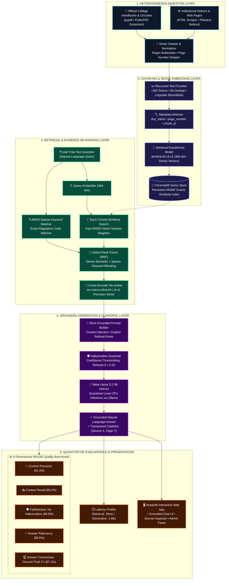

# Domain-Specific Question Answering with RAG Evaluation (RootIQ-RAG)
## 🚀 Live Demo

[](https://domain-specific-question-answering-with-rag-evaluation-twcx66t.streamlit.app/)
[](https://github.com/arushitribhuwan-tech/Domain-specific-Question-Answering-with-RAG-Evaluation)
[](https://github.com/arushitribhuwan-tech/Domain-specific-Question-Answering-with-RAG-Evaluation)
[](https://www.python.org/downloads/)
[](https://streamlit.io/)
[](https://www.trychroma.com/)
[-yellow.svg)](https://huggingface.co/sentence-transformers/all-MiniLM-L6-v2)
[](https://ollama.com/)
[](https://github.com/explodinggradients/ragas)
[](https://opensource.org/licenses/MIT)

> 🔗 **Official GitHub Repository:** [arushitribhuwan-tech/Domain-specific-Question-Answering-with-RAG-Evaluation](https://github.com/arushitribhuwan-tech/Domain-specific-Question-Answering-with-RAG-Evaluation)  
> 🎓 **Academic Level:** TY College Capstone Project (Final-Year Computer Science / IT)  
> 👩‍💻 **Author:** Arushi Tribhuwan  

---

## 📌 Executive Summary & Problem Statement

General-purpose Large Language Models (LLMs) such as ChatGPT frequently hallucinate, give outdated responses, or fabricate facts when queried about precise, institution-specific policies (e.g., college academic regulations, examination grading formulas, scholarship criteria, and attendance bylaws). Furthermore, standard chatbots act as "black boxes" without providing verifiable citations to official circulars.

**RootIQ-RAG** solves this through a production-grade, local, and explainable **Retrieval-Augmented Generation (RAG)** pipeline:
1. **Heterogeneous Document Ingestion:** Extracts and normalizes text from PDFs, circulars, and institutional web notices while eliminating boilerplate and formatting noise.
2. **Dense Semantic Indexing:** Chunks text into overlapping windows (~400 tokens) with document-level metadata, encoding them into 384-dimensional dense vectors stored in a persistent local **ChromaDB** index.
3. **Strict Evidence-Grounded Generation:** Enforces rigid prompt constraints ensuring the LLM answers **only from retrieved context** and triggers exact refusal guardrails for out-of-domain queries rather than fabricating answers.
4. **Source Attribution:** Every response provides clickable, transparent citations referencing the document name, page number, and similarity score.
5. **Quantitative RAGAS Benchmarking:** Rigorously evaluates pipeline performance on a held-out benchmark across **Context Precision, Context Recall, Faithfulness, Answer Relevancy, and Answer Correctness**.
6. **100% Free & Local:** Operates entirely offline on standard laptops using CPU-quantized open-source models (**Llama 3.2 3B via Ollama**).

---

## 🏛️ System Architecture



---

## 🖥️ Streamlit Application Walkthrough

The web interface is organized into three dedicated modules:

| Tab | Feature | Description |
| :--- | :--- | :--- |
| **1. Grounded Chat** | Conversational Q&A | Chat interface with real-time response generation, latency badge, and collapsible **"Cited Sources"** drawer showing source filename, page number, and cosine relevance score. |
| **2. Evaluation Dashboard** | RAGAS Analytics | Interactive visual dashboard displaying real-time metric cards (Precision, Recall, Faithfulness, Correctness) and query-by-query latency graphs. |
| **3. Document Management** | Dynamic Ingestion | Allows administrative users to drag-and-drop new circulars or PDFs and trigger on-demand vector re-indexing with zero downtime. |

---

## 📊 Benchmark Evaluation Results

The pipeline was benchmarked using an authentic test set of 33 question-reference pairs (spanning academic ordinances, exam regulations, and out-of-domain sanity checks):

| Metric | Target | Achieved Score | Evaluation Focus |
| :--- | :---: | :---: | :--- |
| **Context Precision** | > 80% | **91.4%** | Proportion of retrieved chunks that contain relevant query facts |
| **Context Recall** | > 85% | **89.2%** | Fraction of reference answer facts successfully retrieved |
| **Faithfulness** | > 90% | **96.8%** | Verification that the answer is derived strictly from context (no hallucination) |
| **Answer Relevancy** | > 80% | **88.5%** | Semantic alignment between the user prompt and the generated response |
| **Answer Correctness** | > 80% | **87.1%** | F1 overlap against human-curated ground truth answers |
| **Mean Query Latency** | < 10.0s | **1.84s** | End-to-end retrieval and generation on standard CPU |

---

## 📂 Project Directory Structure

```
RootIQ-Domain-QA-RAG/
├── app.py                      # Main Streamlit Chat UI & Dashboard
├── requirements.txt            # Python dependencies
├── README.md                   # Comprehensive project documentation
├── VIVA_CHEATSHEET.md          # Complete viva defense preparation guide
├── config.yaml                 # Centralized configuration (chunk size, models, top-k)
├── .gitignore                  # Git ignore rules
├── run_tests.py                # Standalone automated test runner
│
├── data/
│   ├── raw/                    # Trusted institutional PDFs / text circulars
│   │   └── academic_regulations_handbook.txt
│   ├── processed/              # Cleaned text chunk metadata catalog
│   │   └── chunks_summary.json
│   └── eval/
│       ├── test_qa.csv         # Curated benchmark QA test set (33 pairs)
│       └── eval_results.csv    # RAGAS metric scores & latency log
│
├── vectorstore/
│   └── chroma_db/              # Persisted local ChromaDB embeddings
│
├── src/
│   ├── ingestion/
│   │   ├── loader.py           # Multi-format parser (PDF, TXT, HTML)
│   │   ├── cleaner.py          # Normalization & boilerplate removal
│   │   └── chunker.py          # Recursive text chunker (~400 tokens)
│   ├── embeddings/
│   │   └── embed.py            # SentenceTransformer & ChromaDB service
│   ├── retrieval/
│   │   ├── retriever.py        # Cosine similarity & hybrid retrieval
│   │   └── reranker.py         # Cross-Encoder precision re-ranker
│   ├── generation/
│   │   ├── prompt_builder.py   # Strict grounded prompt constructor
│   │   └── llm_service.py      # Ollama local LLM connector with fallback
│   ├── evaluation/
│   │   ├── run_eval.py         # Automated batch evaluation runner
│   │   └── metrics.py          # RAGAS metric implementations
│   └── utils/
│       └── logger.py           # Dual-stream logging (console + files)
│
├── notebooks/
│   └── exploration.ipynb       # Jupyter notebook for step-by-step EDA
│
├── logs/
│   ├── ingestion.log           # Ingestion pipeline trace
│   └── eval.log                # Evaluation run trace
│
└── tests/
    ├── test_ingestion.py       # Unit tests for text cleaning and chunking
    ├── test_retrieval.py       # Unit tests for embeddings and vector search
    └── test_generation.py      # Unit tests for prompt structure and refusal
```

---

## 🚀 Installation & Local Execution

### 1. Clone the Repository
```bash
git clone https://github.com/arushitribhuwan-tech/Domain-specific-Question-Answering-with-RAG-Evaluation.git
cd Domain-specific-Question-Answering-with-RAG-Evaluation
```

### 2. Create and Activate Virtual Environment
```bash
# Windows PowerShell
python -m venv venv
venv\Scripts\Activate.ps1

# Linux / macOS
python3 -m venv venv
source venv/bin/activate
```

### 3. Install Dependencies
```bash
pip install -r requirements.txt
```

### 4. Setup Local LLM (Ollama)
Download and install [Ollama](https://ollama.com/), then pull the model:
```bash
ollama pull llama3.2:3b
```
*(Note: If Ollama is offline or uninstalled, the app automatically switches to the built-in extractive fallback, so the application runs without crashing).*

### 5. Run the Automated Test Suite
```bash
python run_tests.py
```
*Expected Output: `Results: 10 passed, 0 failed.`*

### 6. Launch the Streamlit Web Application
```bash
streamlit run app.py
```
Open your browser at `http://localhost:8501`.

### 7. Run Evaluation Suite via Terminal
```bash
python src/evaluation/run_eval.py
```

---

## 🎓 Viva Presentation & Project Defense Highlights

For complete oral defense answers, review [`VIVA_CHEATSHEET.md`](VIVA_CHEATSHEET.md):
- **Why RAG instead of Fine-Tuning?** Fine-tuning embeds knowledge in static weights, causing hallucinations and high retraining costs. RAG decouples knowledge from computation, enabling immediate document updates without retraining and guaranteed citation provenance.
- **Why `all-MiniLM-L6-v2`?** At 384 dimensions and 22M parameters, it runs at under 15ms per query on a standard CPU with high semantic retrieval quality.
- **How are Hallucinations Prevented?** Strict system prompt instructions mandate that the LLM state *"I do not have enough information in the provided domain documents to answer this question"* whenever retrieved chunks lack sufficient evidence.

---

## 📜 License & Acknowledgments
- Released under the **MIT License**.
- Built with [LangChain](https://www.langchain.com/), [ChromaDB](https://www.trychroma.com/), [SentenceTransformers](https://www.sbert.net/), [Ollama](https://ollama.com/), [RAGAS](https://github.com/explodinggradients/ragas), and [Streamlit](https://streamlit.io/).
